<p align="center">
  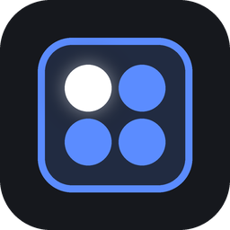
</p>

<h1 align="center">Barline -- Song and Setlist Planner</h1>

<p align="center">Plan your set, and keep everyone in sync on stage.</p>

Barline is a tool for bands and other music groups to work out a song's
structure together -- sections, tempo, count-ins, and reminders for each
player -- and then put it on every musician's own tablet or phone, all
moving through the song together, each with its own click.

*Called SSP until version 0.17.0; nothing changes for your songs. Coming
from SSP? See [Renamed from SSP](#renamed-from-ssp).*

### See it in two minutes

[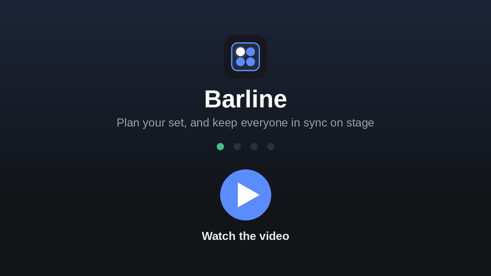](https://giopas.github.io/Barline/video/)

The picture opens [a page that plays the video](https://giopas.github.io/Barline/video/)
in the browser. To keep or send them on: the [video](https://github.com/giopas/Barline/releases/latest/download/Barline_Pitch.mp4)
(vertical, made for a phone, so it drops straight into a band's WhatsApp chat)
and the same [slides as a PDF](https://github.com/giopas/Barline/releases/latest/download/Barline_Pitch.pdf).
Both are made again with every release.

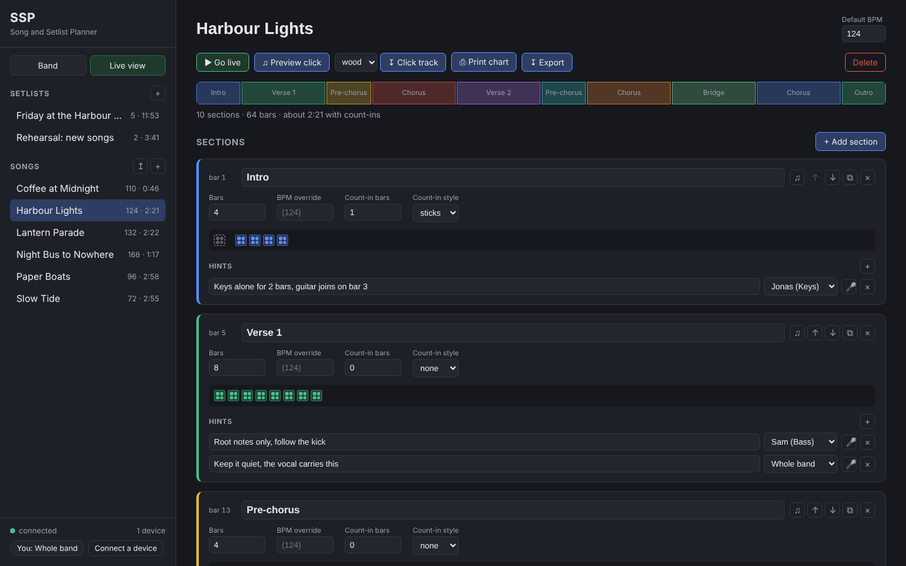

## What it does

- **Draft a song's structure as a band.** Verses, choruses, bridges, however
  you think about your songs. Bars and tempo per section (a half-time bridge
  can have its own BPM), a count-in of its own (1, 2, 4 bars or any 0 to 8, with a Listen button;
  or set them for every song in one go: at the start, at every section change,
  or where the tempo changes), and hints: a note for the whole band,
  or one aimed at a single player ("Bass: root notes only here"). A hint can
  carry a short voice memo too.
- **Everyone edits the same copy.** Change a bar count on the laptop and the
  singer's phone updates a moment later. No refresh, no "which version is
  the latest".
- **Build setlists** and switch between songs instantly. Drag songs into
  playing order; the song list follows the setlist you're on. Tag songs
  (own song, a cover's artist, ballad, encore...) and filter by tag, or
  search a setlist. In a hurry? Paste
  your set ("Song A - 124", one per line) or tap a tempo in: a title and a
  BPM is all the click needs.
- **Play it live.** Anyone can press Start -- usually the drummer. Every
  screen follows the song bar by bar, shows what's coming next, and puts
  *your* hints up front. Each device plays its own metronome click in time,
  set up its own way (wood, beep, tick, ride bell, cowbell, finger snap,
  side stick): subdivisions, a spoken count-in, one ear only for a
  Y-splitter into in-ears, a click for count-ins only. Per song, a click
  pattern: a different sound and accent on each beat of the bar (wood on 1,
  beeps after; accents on 2 and 4). Drummers get a big
  view (tempo, bar, bars to the next part), and a device keeps playing on
  its own if the server drops mid-song. Mid-song, jump to any section from
  the next bar line (the singer went to the chorus early), or nudge the
  click ahead if it started late.
- **Put it on paper.** A song's chart as a PDF, for the whole band or one
  player: tempo, how it starts, the song's shape, each section's first bar,
  a box per bar to count along on, tempo changes, count-ins and hints. It
  grows to fill the page, or makes a **floor sheet** in the biggest type
  that fits on one page; colour, or black and white. A setlist prints its
  running order in big type, then one chart per song.
- **Take it with you.** Download a practice click track (`.wav`) that follows
  the song's tempo changes (or a `.zip` of them for a whole setlist), or
  export a song, a setlist or everything (voice memos included) as a single
  file for another band. A song's PDF carries the song too, so another
  Barline can import the printout's file.
- **Practise at home with Barline Pocket.** The same app with no server, on
  your own phone, tablet or computer: open
  [giopas.github.io/Barline](https://giopas.github.io/Barline/), install it
  (Chrome, Edge, Safari: the steps for each are in the app under "Use
  offline" and in the [wiki](https://github.com/giopas/barline/wiki/Barline-Pocket)),
  import the band's file. It works offline. Bring
  your notes back as a file: songs the band already has are **merged**, with
  hints from both copies, each one showing who wrote it, and you choose which
  structure to keep when the two differ.

| A bass player's chart | The set's running order, and a floor sheet |
|---|---|
| 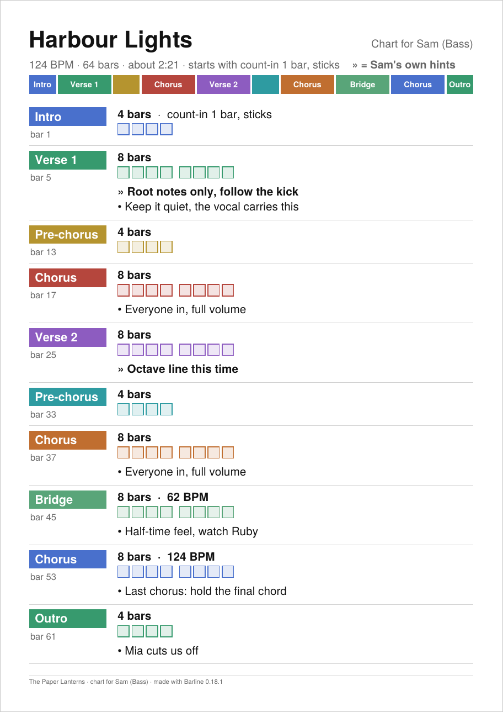 | 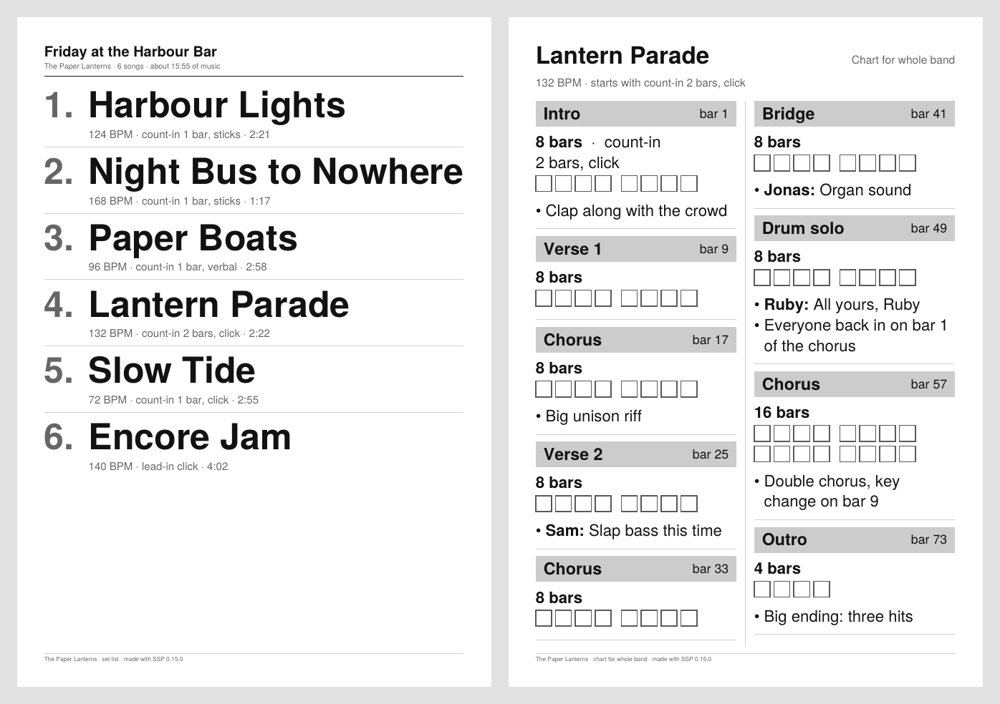 |

| Barline Pocket on a phone | Merging a Pocket file back into the band's copy |
|---|---|
| 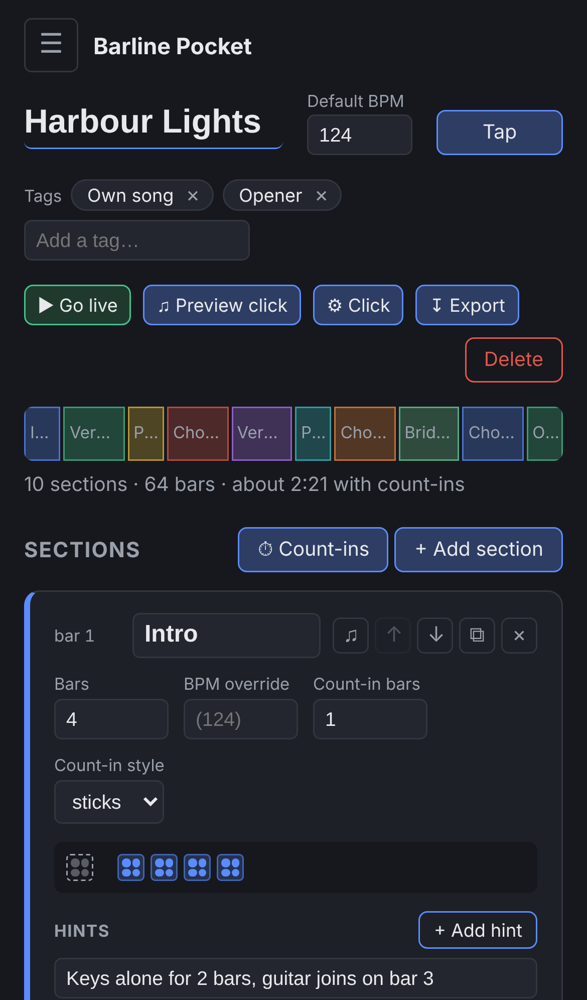 | 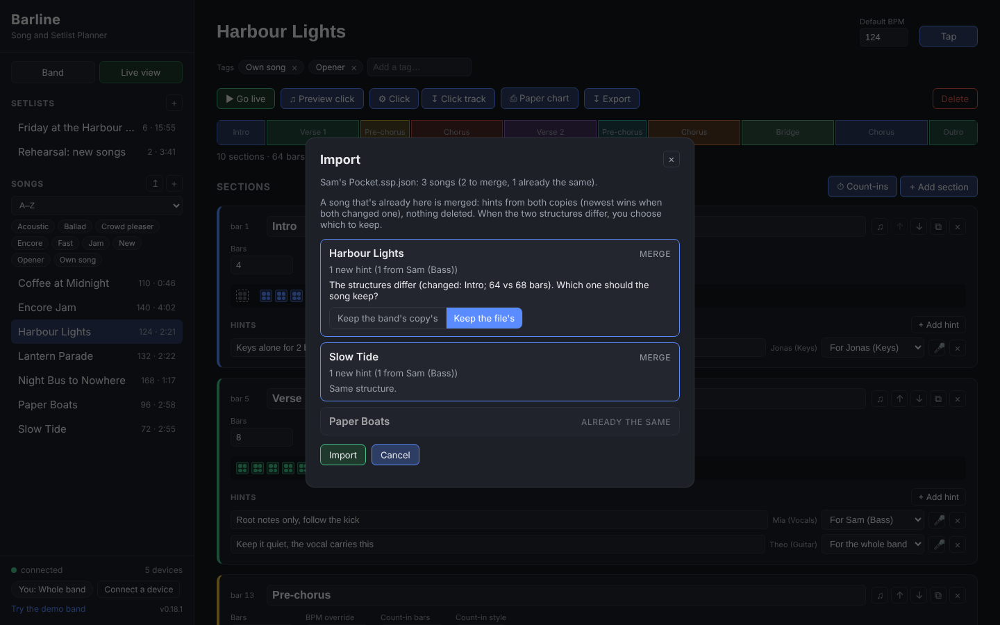 |

| On the drummer's tablet | On the bassist's phone |
|---|---|
| 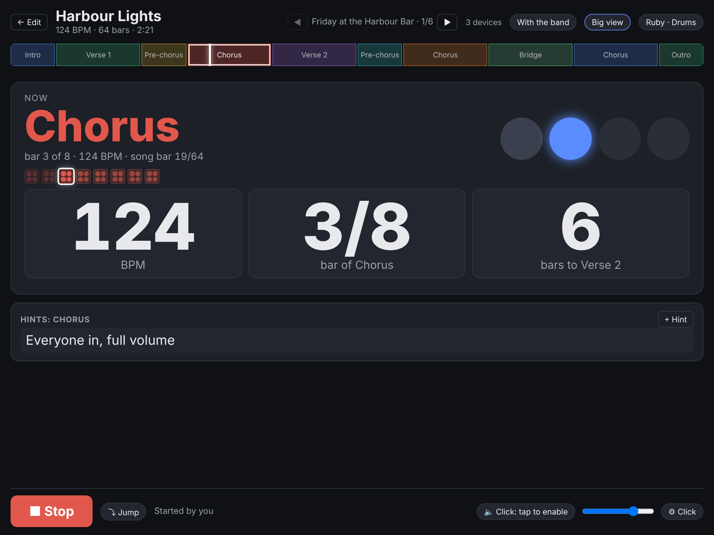 | 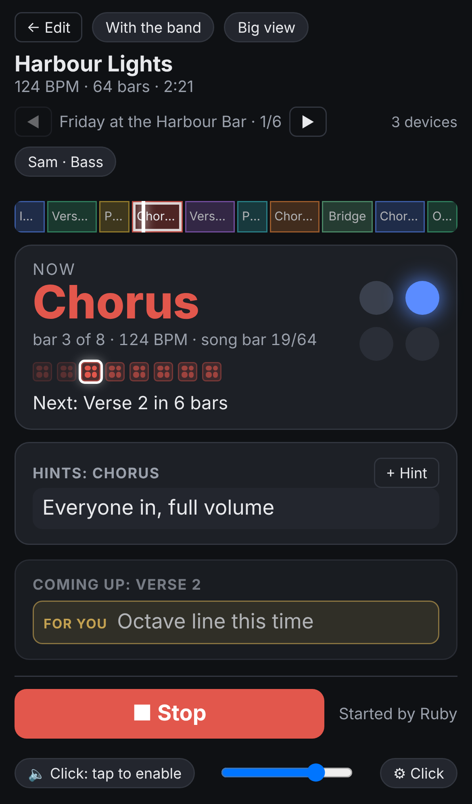 |

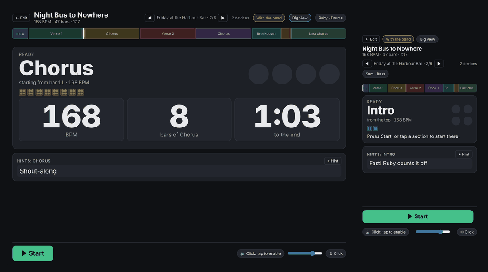

Coming from a metronome app? See [For Drummers](https://github.com/giopas/barline/wiki/For-Drummers).

## How it works

One small server -- a laptop, a Raspberry Pi, or similar -- runs on your own
Wi-Fi and holds the whole band's songs and setlists. Everyone in the room
opens the same address in their phone or tablet's browser (or scans the QR
code the server shows). There's no app to install, no account, and no
internet connection involved at all.

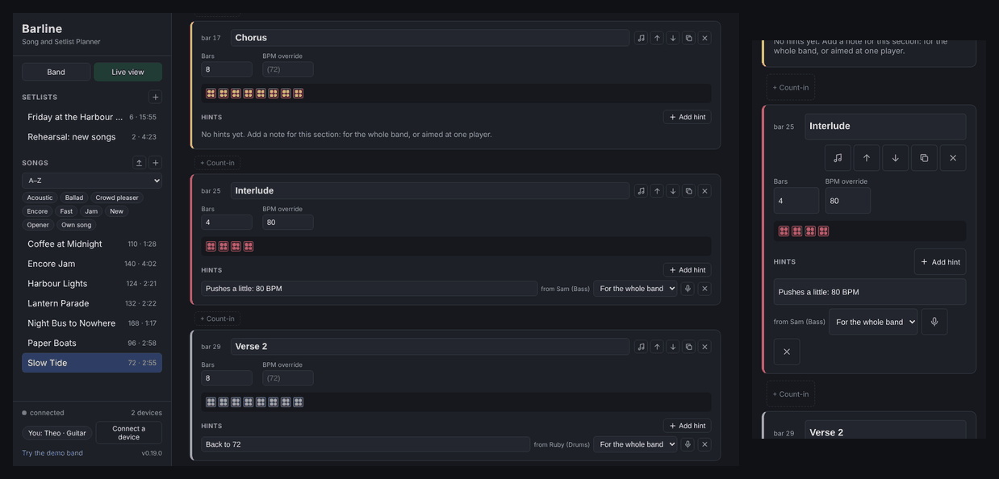

**Local network only, on purpose.** Barline is never meant to be reachable over
the internet: a remote server is exactly the kind of lag and dropped
connection a rehearsal or a live set can't afford. The server makes no
outbound connections, sends no telemetry, and only reads and writes its own
data folder. (The desktop control panel asks GitHub for updates, once, when it
opens: see [Privacy and security](#privacy-and-security).)

**Trust model:** anyone on the same Wi-Fi who has the address can read and
edit everything. There's no per-user login -- treat the address the way
you'd treat a whiteboard in your rehearsal room.

## Install

**Download, open, start.** From the [latest release](https://github.com/giopas/barline/releases/latest),
take the file for your computer. Nothing else to install: Python comes inside.

| Computer | File | Then |
|---|---|---|
| macOS, Apple silicon (M1 and later) | `Barline-<version>-macos-arm64.dmg` | open it, drag **Barline** to Applications |
| macOS, Intel | `Barline-<version>-macos-x86_64.dmg` | the same |
| Windows 10/11 | `Barline-<version>-windows-x64-setup.exe` | run the installer (no administrator needed; Start menu entry, uninstaller). Or the `…-windows-x64.zip`: unzip, run `Barline.exe` |
| Linux (x64) | `Barline-<version>-linux-x64.tar.gz` | `tar xzf Barline-*-linux-x64.tar.gz`, then `./Barline/Barline` |

The macOS `.tar.gz` files in the release are for Barline's own updater: take the
`.dmg`. Only one computer in the band needs Barline; everyone else just opens the
address in a browser.

### The first time you open it

The apps aren't signed (that costs a yearly fee to Apple and Microsoft), so the
system asks once.

**macOS.** If it says Barline "can't be opened" or "is damaged", it's the download
quarantine, not a broken app. Any one of these fixes it:

- right-click (or Control-click) **Barline** in Applications and choose **Open**,
  then **Open** again;
- on macOS 15 Sequoia and later: try to open it once, then **System Settings ›
  Privacy & Security**, scroll down and click **Open Anyway**;
- or in Terminal:

  ```bash
  xattr -dr com.apple.quarantine "/Applications/Barline.app"
  ```

**Windows.** SmartScreen shows "Windows protected your PC": click **More info ›
Run anyway**.

**Let phones and tablets in.** The first time you press **Start server**, the
system may ask whether Barline can accept incoming connections or find devices on
your local network (macOS), or show a Windows Defender Firewall prompt. Click
**Allow** (on Windows, tick **Private networks**). Say no and Barline runs, but no
phone can reach it. To change it later: macOS **System Settings › Network ›
Firewall** and **Privacy & Security › Local Network**; Windows **Allow an app
through Windows Firewall**.

**Check the download** (optional). Each release has a `SHA256SUMS` file. In the
folder with both files:

```bash
shasum -a 256 -c SHA256SUMS --ignore-missing     # macOS
sha256sum -c SHA256SUMS --ignore-missing         # Linux
```

On Windows: `certutil -hashfile Barline-<version>-windows-x64-setup.exe SHA256`, and
compare with the line in `SHA256SUMS`.

### Updating

When a new version is out, a blue bar appears at the top of the control panel.
**Update and restart** downloads it, checks it against the release's
checksums, swaps it in and starts Barline again; your songs and settings stay as
they are. The same way QLC+ Swiss Knife does it. Barline asks GitHub once when the
control panel opens (nothing about you or your band is sent, and with no
internet it stays quiet). **Auto-check updates** at the bottom switches that
off; **Check for updates** asks on demand. Coming from 0.12.0 or older, download
the new version by hand once.

### Uninstalling

Delete the app (macOS: drag Barline from Applications to the Bin; Windows:
**Settings › Apps › Barline › Uninstall**, or delete the unzipped folder; Linux:
delete the `Barline` folder). Your songs stay in the folder you picked for them.
The control panel's settings are in:

| | |
|---|---|
| macOS | `~/Library/Application Support/SingleSongPlanner/` |
| Windows | `%APPDATA%\SingleSongPlanner\` |
| Linux | `~/.config/single-song-planner/` |

### Renamed from SSP

Up to 0.16 the app was called **SSP**. 0.17.0 is the same app under its new
name: your songs, setlists and settings stay where they are (the data
folder and each device's saved settings are untouched), and song files
exported by SSP (`.ssp.json`) still import, as do the song PDFs. The one
step by hand: SSP 0.16 looks for files named `SSP-...` and so can't update
itself to Barline. Install 0.17.0 once from the release page, then
delete the old **SSP** app. From then on it updates itself again. On a
Raspberry Pi: `git remote set-url origin https://github.com/giopas/barline.git`,
`git pull`, and run `install.sh` again as before (its service is still
called `ssp`, its address still `ssp.local`).

## Run from the source code

Same app, for a laptop where you'd rather not use the download, or for a
Raspberry Pi.

| Requirement | Details |
|---|---|
| Python | 3.9 or newer. The server uses only the standard library: nothing to `pip install` |
| Tk | for the control panel. Included with python.org's installers for macOS and Windows; on Linux `sudo apt install python3-tk` |
| Phones and tablets | any recent browser (Safari, Chrome, Firefox, Edge) |

**First time:**

```bash
git clone https://github.com/giopas/barline.git
cd barline
python3 launcher/gui.py          # Windows: python launcher\gui.py
```

**Every later run:** double-click `launchers/start-macos.command` (macOS),
`launchers/start-windows.bat` (Windows) or run `launchers/start-linux.sh`
(Linux). Or `python3 launcher/gui.py` as above.

**Updating:** `git pull` in that folder. The control panel's update bar says
so too.

**No screen, or a Raspberry Pi:** skip the control panel and run the server
itself: `python3 server/app.py` (`--port`, `--data <folder>`, `--demo`; see
`--help`). On a Pi, `launchers/pi/install.sh` sets it up as a service in one
command: see the wiki page *Running on a Raspberry Pi*.

## First run

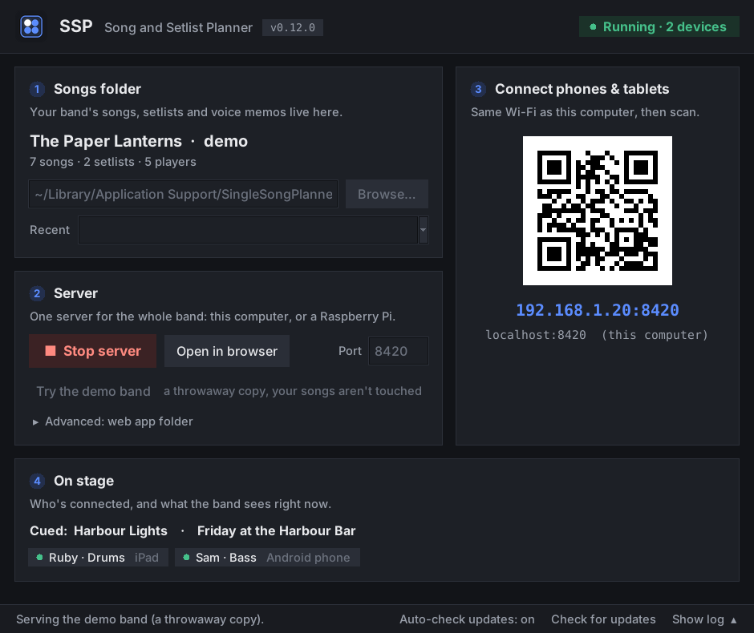

1. Pick (or create) a folder for your band's songs. The panel remembers it.
2. Click **Start server**. It shows the address and a QR code, and the
   **On stage** card lists each phone or tablet as it connects.
3. On each phone or tablet, join the same Wi-Fi and scan the code or type
   the address.
4. Start planning. Everything is saved as you go.

**No Wi-Fi in the room?** The Connect card's **Make a Wi-Fi** button makes
this computer the band's Wi-Fi (`Barline-Band`, with a password Barline makes up)
and shows two codes: one joins the Wi-Fi, one opens Barline. One click on Linux
(NetworkManager) and on Windows when Windows allows it (Mobile hotspot;
with no network at all it needs a one-time Loopback Adapter setup); on a
Mac it opens System Settings › Sharing and shows the steps, since macOS
doesn't let apps turn Internet Sharing on. The wiki page *No Wi-Fi at the
Venue* has the details and the other ways (a phone's hotspot, a travel
router, a Raspberry Pi, which makes its own Wi-Fi by itself at boot when it
finds no network it knows).

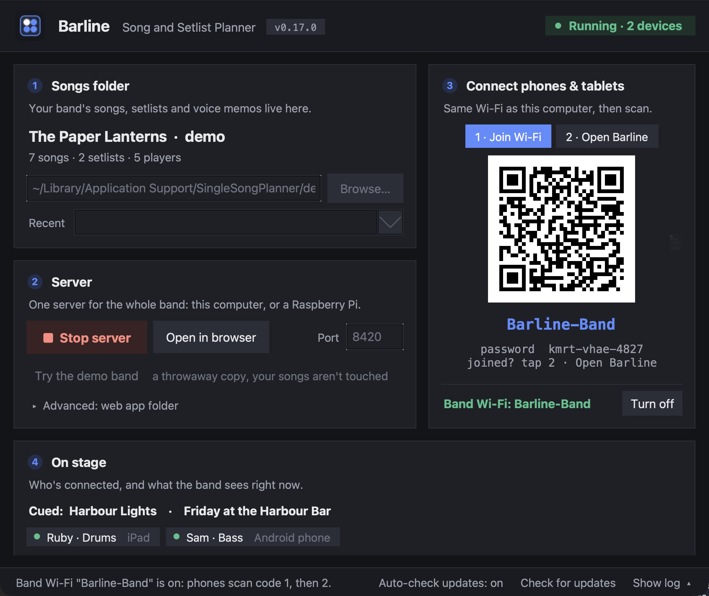

Want to look around first? **Try the demo band** (in the control panel, or
at the bottom of the sidebar in the app itself, where it switches every
connected device at once) loads a fictional band
(The Paper Lanterns) with seven songs and two setlists. It's a throwaway
copy, so nothing you do there sticks. From a terminal:
`python3 server/app.py --demo`.

**Nobody can connect?** Check that the phone is on the same Wi-Fi as the
computer (not on mobile data, not on a guest network that keeps devices
apart), that you allowed Barline through the firewall (above), and that you typed
`http://`, not `https://`. The wiki page *Getting Started* (step 4) has more.

## Supported platforms

| Platform | Status |
|---|---|
| macOS 11 or later, Apple silicon and Intel | app built and self-tested on every release; tested by hand from the source code |
| Windows 10/11 (x64) | app and installer built, installed and self-tested on every release |
| Linux x64 (Ubuntu 22.04 or newer, and similar) | app built and self-tested on every release |
| Raspberry Pi (Raspberry Pi OS) | from the source code, as a service |
| Phones and tablets | the browser: iPhone/iPad (Safari), Android (Chrome); tested on an iPad and an Android phone |

## Privacy and security

Everything stays in your rehearsal room. The server listens on your local
network only: never put it on the internet (no port forwarding). There are no
accounts and no telemetry, and the songs are plain JSON files in the folder you
picked. Anyone on the same Wi-Fi who has the address can read and edit
everything (see the trust model above).

The only internet request is the update check, made by the desktop control
panel (not by the server the band's devices use): once when it opens, to
GitHub, with nothing about you or your band. Switch it off with **Auto-check
updates**.

## More

The [wiki](https://github.com/giopas/barline/wiki)
walks through planning a song, using it on stage, the metronome, printing,
moving songs between setups, Barline Pocket, and running Barline on a
Raspberry Pi.

| Setlists | The band | Connect a device |
|---|---|---|
| 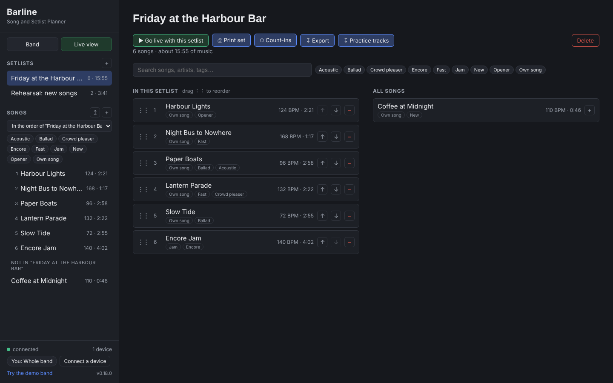 | 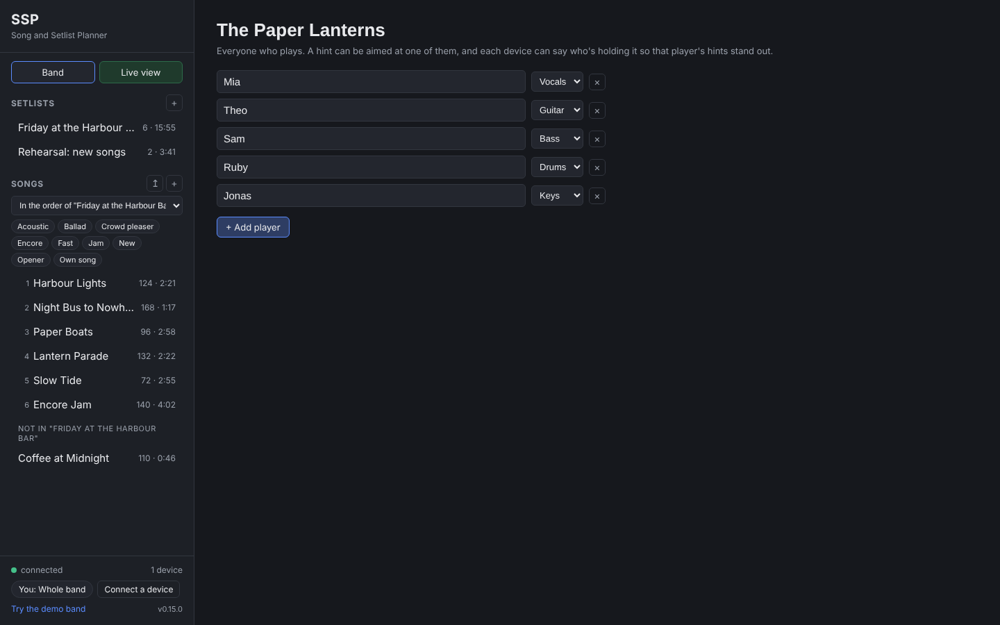 | 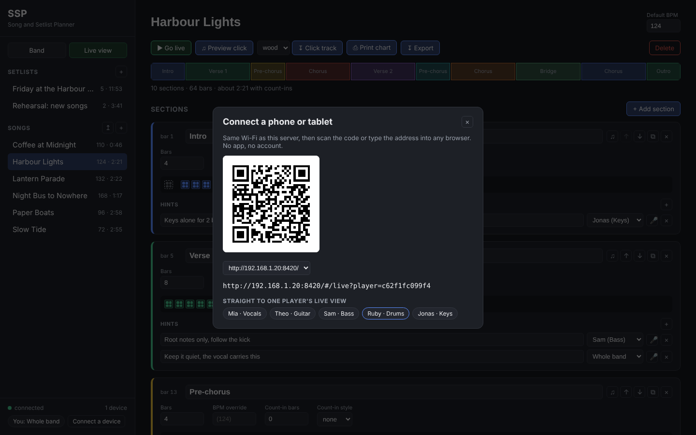 |

## For developers

- `python3 -m unittest discover -s tests` runs the tests (the browser tests
  need Playwright and are skipped without it).
- `python3 tools/make_demo_data.py` regenerates `demo/`;
  `python3 tools/shots.py` retakes every screenshot and GIF in
  `screenshots/` from the demo band.
- `python3 tools/build_pocket.py` builds Barline Pocket (the web app with no
  server) into `dist/pocket/`; `.github/workflows/pocket.yml` publishes it to
  GitHub Pages on every version tag. Merging lives in `web/static/files.js`
  (shared by the server's web app and Pocket); Pocket's in-page stand-in for
  the server is `web/static/pocket.js`.
- `tools/make_voice.sh` rebuilds the spoken count-in (`web/static/voice/`).
- `python3 tools/make_icons.py` redraws the app icon (the bar square with
  beat 1 lit) and writes every size: browser tab, home screen, macOS
  `.icns`, Windows `.ico` (needs Pillow).
- `tools/publish_wiki.sh` publishes `wiki/` to the GitHub wiki (a separate
  repo, not updated by pushing `main`); `--check` says whether it's behind.
  Run it after every push that changed a wiki page.
- `launchers/pi/install.sh` sets up a Raspberry Pi in one command (see the
  wiki's "Running on a Raspberry Pi").
- No build step: the web app in `web/static/` is plain HTML, CSS and
  JavaScript.

### Building the apps

Pushing a version tag (`git tag v0.10.1 && git push origin v0.10.1`) builds
the apps for every OS on GitHub (`.github/workflows/release.yml`), checks
each one starts and serves the web app, and attaches them to the release
with that version's CHANGELOG section. The same recipe as QLC+ Swiss Knife.

To build one yourself, on its own OS (PyInstaller doesn't cross-compile):
`packaging/build-macos.sh`, `packaging\build-windows.bat` or
`packaging/build-linux.sh`. Any build checks itself with `--smoke`, and
`--headless [server options]` runs it as a plain server with no window
(on Windows, use `Barline Server.exe` for both).

## Credit

Barline's song-structure focus takes its cue from
[song-map.com](https://song-map.com/). The "one local server, every device a
synced client" pattern, the per-player "tablet on stage" idea, the QR code
encoder, the click-track sounds, the updater and the look of the control panel are adapted from
[QLC+ Swiss Knife](https://github.com/giopas/qlc-plus-swiss-knife-tool-script).
The paper charts (the PDF writer, Fit to page, the floor sheet, black and
white, the song carried inside its PDF) come from
[Song Notation Tool](https://github.com/giopas/song-notation-tool).

## License

MIT -- free and open source, forever. See `LICENSE`. What's changed in each
version is in `CHANGELOG.md`.
