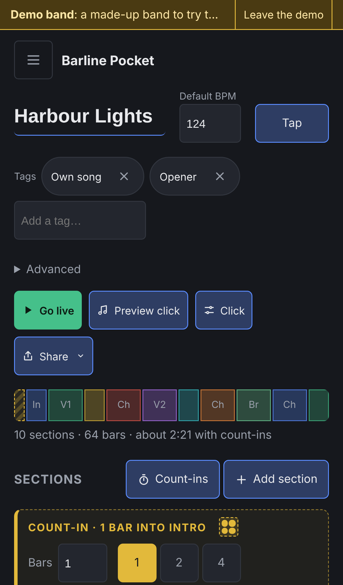
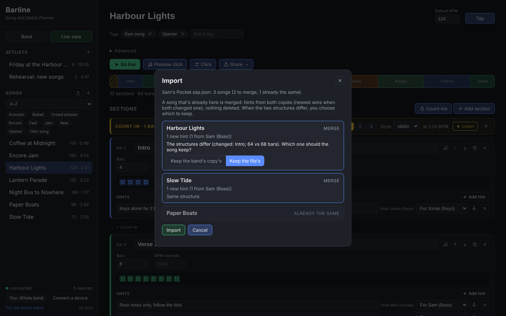

# Barline Pocket

Barline normally runs on one computer in the rehearsal room, and every phone connects to it. That's right for rehearsals and gigs, but at home there's no server. **Barline Pocket** is the same app with no server: it runs on its own on your phone, tablet or computer, keeps the band's songs on that device, and works with no internet.

Use it to practise with the click, look at a song's shape on the bus, or write notes ("walk up to the chorus on the A string") at home. Your notes go back to the band in a file, and the band's Barline merges them in.

| Pocket on a phone | Bringing Sam's notes back to the band |
|---|---|
|  |  |

## Open it, and make it work offline

Open **[giopas.github.io/Barline](https://giopas.github.io/Barline/)** (with a capital B) on the device. It needs the internet this first time.

From then on it works with no internet in any modern browser, at the same address. But **install it** too: it gets its own icon and window, and your songs are safer. A browser may clear the storage of websites you haven't opened for a while (Safari does after a few weeks), but not of installed apps.

How to install it, by browser:

| Browser | How |
|---|---|
| **Chrome** on a computer (Windows, Mac, Linux) | The install icon at the right end of the address bar, or &#8942; menu → **Cast, save and share** → **Install Barline Pocket…** → **Install**. It then opens in its own window, from the Start menu, Launchpad or Dock. |
| **Edge** on Windows | **…** menu → **Apps** → **Install this site as an app** → **Install**. |
| **Safari** on iPhone or iPad | The Share button (square with an arrow) → **Add to Home Screen** → **Add**. Then always open Pocket from that icon: the songs belong to the icon, not to Safari. |
| **Safari** on a Mac | **File → Add to Dock** (macOS Sonoma or later). |
| **Chrome** on Android | &#8942; menu → **Add to home screen** (or **Install app**) → **Install**. |
| **Firefox** | On Android: menu → **Add to home screen**. On a computer, Firefox can't install it, but it still works offline in a tab once opened online: bookmark it, and export your songs now and then. |

In Pocket, **Use offline** (bottom of the side bar) shows these steps for the browser you're in, says whether this device is ready to work offline, and in Chrome and Edge has an **Install** button. Once it's installed and ready, the link reads "✓ Offline ready".

Each install keeps its own songs: Pocket in Chrome and Pocket in Safari on the same computer don't see each other's songs, and neither does another device. Files move songs between them (below).

Nothing to buy or sign up for, and no app store: it's a web page that keeps itself on your device.

## Get the band's songs onto it

On the band's Barline (the laptop or the Pi):

- **Band → Export everything** makes one file with every song, setlist, player and voice memo.
- Or open a setlist and choose **Share → Export**: that setlist, its songs and the players.

Send the file to your phone: email it to yourself, AirDrop it, or put it in Files, iCloud Drive or Google Drive. Then in Pocket, press **Import a file** and pick it. The first time, Pocket asks who you are in the band, so it knows which hints are yours and whose name to put on the notes you write.

Want a look first? **Try the demo band** loads the made-up band from the screenshots. A banner at the top says you're in the demo; **Leave the demo** there empties Pocket again, ready for your band's file. If you import a file while the demo is still loaded, Pocket offers to leave the demo first, so your songs don't mix with the demo's.

To start over at any time, **Band → Delete everything on this device** empties Pocket on that device (export first if you want to keep anything).

## What works in Pocket

Everything about planning a song: sections, bars, tempo, count-ins, hints, voice memos (on a phone you can record one straight in), tags, setlists. The live view and the click work too, on your device only. Your own Start and Stop, no band to follow.

What Pocket can't do, because it has no server: connect other devices, print paper charts, or download click-track files. Do those on the band's Barline.

## Bring your notes back

In Pocket, **Band → Export everything** (on a phone this opens the share sheet: Mail, AirDrop, Files...). Then, on the band's Barline, press **⇡** next to Songs (or **Band → Import a file**) and pick that file.

A song the band's Barline already has is **merged**, not added a second time:

- **Hints come from both copies.** A note only you wrote is added. A note the band wrote while you were away stays. Nothing is deleted by a merge.
- **When both copies changed the same hint**, the one changed most recently wins. The import screen says when that happened.
- **Each hint says who wrote it**: "Sam (Bass)", next to the hint in the editor and in the live view. That's the player each device said it was being used by.
- **The structure comes from one copy.** If both copies have the same sections, bars and tempo, there's nothing to decide. If they differ (you made the intro four bars longer at home, say), the import screen shows the difference and asks which one to keep: **Keep the band's copy's** or **Keep the file's**. It doesn't guess. A hint whose section isn't in the structure you keep moves to the section with the same name, or the one in the same place.

The import screen lists every song in the file before anything changes: which ones are new, which will be merged (with "2 new hints from Sam (Bass)"), and which are already the same. Nothing happens until you press **Import**.

It works the other way too: export from the band's Barline after rehearsal and import that file in Pocket, and the band's latest changes merge into your copy.

## Keep a copy

Pocket keeps your songs in the phone's browser storage. That's reliable once Pocket is on the home screen, but if you clear the browser's data, or never open Pocket from the home screen for a long time, the phone may delete it. Export now and then: the file is your backup, and the band's Barline is the main copy anyway.

## For the curious

Pocket is the same web page as the band's Barline, built into a static site by `tools/build_pocket.py` and published to GitHub Pages with each release. Instead of asking a server, it answers its own requests in the page and stores everything in the browser (IndexedDB). It can't talk to the band's server directly: the server is plain `http://` on your Wi-Fi and Pocket is `https://`, and browsers don't allow that mix. That's why the way back is a file.
