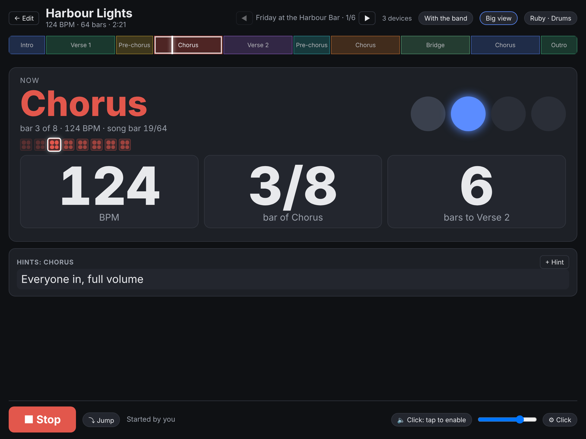

# For Drummers

If you already run your click from a metronome app on an iPad or phone, this page is for you. Barline can do that job, plus show the whole band where you are in the song. You don't have to plan any song structure to start: a title and a tempo is enough.

## Five minutes from metronome app to Barline

1. **Get your tempos in.** In the sidebar, press **+** next to *Songs*, then **Paste a list**. Type or paste your set, one song per line: `Harbour Lights - 124`, or `Paper Boats, 96, 3:45` with a length. Tick **Also make a setlist** and press **Add**. That's your whole set, in order, ready to play. No tempo to hand? Type the title, hit **Tap** a few times along with the song.
2. **Say it's you.** Tap **You: …** at the bottom of the sidebar and pick yourself. Because you're down as *Drums*, the live view opens in **Big view**: huge tempo, bar count, and how many bars until the next part.
3. **Set up your click.** In the live view, press **⚙ Click**: pick the sound, eighths or sixteenths, a spoken count-in ("one, two, three, four") and which ear it goes to. Then press **Test the click** with your splitter and in-ears plugged in, exactly as on stage. If you hear it, you're done.
4. **Play.** **▶ Start** (or a foot pedal: Space starts and stops, the arrow keys change song).

Everything in **⚙ Click** belongs to your device only. The singer can have no click at all; the beat is still shared.

## The click settings

| Setting | What it does |
|---|---|
| Sound | wood, beep, tick, ride bell, cowbell, finger snap or side stick. Beat 1 is always higher. |
| Subdivision | quarters only, 8ths, 16ths or triplets, played quieter between the beats. |
| Ear | both, left only or right only. With a Y-splitter into in-ears, a click in one ear can sit next to the band mix in the other. |
| Click plays | the whole song, or **count-ins only**: the band gets counted in, then it's your groove. |
| Spoken count-in | the count-in is spoken instead of clicked. A two-bar count-in goes "one … two …, one two three four". |
| Volume / Beat 1 / Other beats / Subdivisions | how loud each one is. Slide one to zero to drop it. |
| Timing nudge | if the click sounds late in your ears (Bluetooth does that), slide it left until it sits. |
| Keep the screen on | stops the tablet locking in the middle of a song. |
| If the server drops mid-song, keep playing | see below. |

## When the laptop or Wi-Fi goes away

- **In the middle of a song**: your tablet keeps clicking to the end of the song (and on into the next one in the setlist), showing *Server out of reach: playing on, on this device only*. When the server is back, you rejoin the band as soon as you stop.
- **Practising on your own**: tap **With the band** at the top of the live view to switch to **Solo**. Start and Stop now only work on your device, from the songs it already has, so you can run a song while the others are still tuning.
- **At home, with no server at all**: on a setlist, press **⬇ Practice tracks**. You get a `.zip` with one click track per song, made with your click settings (subdivisions, spoken count-in, one ear). Play them in any music app.

Solo needs the live view to have been open once while connected to the server, so your device has a copy of the songs. Opening Barline from scratch still needs the server.

## Make it feel like an app

On an iPad: open Barline in Safari, then **Share → Add to Home Screen**. It gets its own icon, opens full-screen, straight into the live view. On Android: Chrome's menu → **Add to Home screen**.

While you're in Settings, set **Display & Brightness → Auto-Lock** to *Never* for gigs. Barline also tries to keep the screen on by itself, but the setting is the sure way.

## Never touch the setup again

A Raspberry Pi in your gig bag can run Barline and its own Wi-Fi from the moment it's plugged in: join the Wi-Fi, open `http://ssp.local/`, play. One command sets it up, see [[Running on a Raspberry Pi]].
