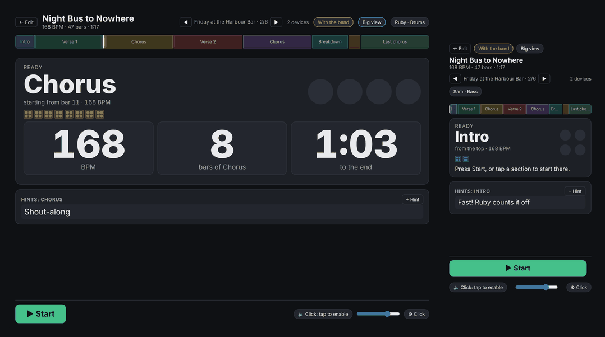

# Barline: Song and Setlist Planner Wiki

*(Barline was called SSP up to version 0.16.)*

Barline helps a band plan how a song goes: which part comes next, how many bars it lasts, what tempo to play it at, and what to remind each other right before it happens. Then it puts that plan on every phone or tablet on stage, moving through the song in time, with a click for whoever wants one.

Think of it as a shared whiteboard for your set, except it's on everyone's phone instead of taped to an amp. One small program runs on a laptop (or a tiny computer like a Raspberry Pi) in the rehearsal room, and every band member just opens a web page. No app to install, no account, no internet needed.

It builds on two things:

- **[song-map.com](https://song-map.com/)**, for the idea that a song's shape (verse, chorus, bridge, how long each part is) deserves its own simple tool instead of being buried in a PDF chart or a group chat.
- **[QLC+ Swiss Knife](https://github.com/giopas/qlc-plus-swiss-knife-tool-script)**'s "Tablet on stage" idea: every musician gets their own screen that follows the show, instead of everyone squinting at one shared monitor.

## Pages

- **[[Getting Started]]**: start the server, connect every phone, try the demo band. About ten minutes.
- **[[Planning a Song]]**: sections, bars, tempo, count-ins, hints and voice memos, and building a setlist.
- **[[Tablet on Stage]]**: what it looks like when you're playing. Starting a song, following along, your own hints, setlists.
- **[[Metronome and Click Tracks]]**: the click on each device, and practice click tracks to download.
- **[[For Drummers]]**: coming from a metronome app? Your set and click in five minutes, the big drummer view, and what happens if the Wi-Fi drops.
- **[[Printing and Moving Songs]]**: paper charts as PDFs (whole band or one player, floor sheets, set lists), and taking a song to another setup.
- **[[Barline Pocket]]**: the songs on your own phone or tablet with no server, to practise and take notes at home, then merge your notes back into the band's copy.
- **[[No Wi-Fi at the Venue]]**: one click makes the computer the band's Wi-Fi; or a phone hotspot, a travel router, a Pi.
- **[[Running on a Raspberry Pi]]**: a small always-on box that runs Barline on its own, even with no Wi-Fi at the venue.

## Elsewhere in the repo

These are plain files in the repo, for someone looking at the code rather than a musician looking for help:

- [README.md](https://github.com/giopas/barline/blob/main/README.md): the short version of what Barline does and how to start it
- [CHANGELOG.md](https://github.com/giopas/barline/blob/main/CHANGELOG.md): what changed in each version
- [screenshots/](https://github.com/giopas/barline/blob/main/screenshots): every picture on these pages, retaken from the demo band by `tools/shots.py`
