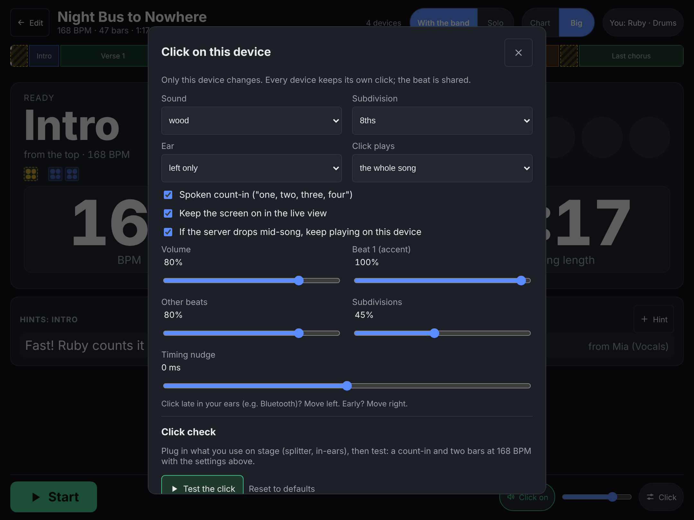

# Metronome and Click Tracks

Barline has a click in two places: live on each device, and as a sound file you can download to practise with.

## The click on each device

In the live view, every phone and tablet can play its own click, in time with the band's run. It's the device making the sound, not the server sending it, so it doesn't lag over Wi-Fi. Each device has its own settings:

- **Click on/off**: the first tap turns sound on (browsers only allow sound after a tap); after that it toggles.
- **Volume**, the slider next to it.
- **⚙ Click** for the rest: the sound (wood, beep, tick, ride bell, cowbell, finger snap or side stick; beat 1 is always higher, so you know where "one" is), 8ths, 16ths or triplets between the beats, a spoken count-in ("one, two, three, four"), left or right ear only, a click for count-ins only, the loudness of each part, and a timing nudge. [[For Drummers]] goes through each one.

## Click check

At the bottom of **⚙ Click**, **Test the click** plays a count-in and two bars with your settings, right there, no song needed. The button turns into Stop while it plays, four dots follow the beat and a line says where it is. It won't run while a song is playing (that click would be replaced): stop the song first. Plug in what you use on stage first (headphones, a Y-splitter into your in-ears) so you test the real thing. Under the button, Barline shows what the device reports: whether the sound engine is running, mono or stereo output (left/right only works in stereo), and on iPhone/iPad whether the silent switch can mute it.

The drummer might want it in their in-ears while the singer leaves it off. Each device remembers its own choice.

The click needs the screen on: when a phone or tablet goes to sleep it stops clicking (it can't hear "stop" any more), and starts again when you wake it, if the song is still going. Barline keeps the screen on in the live view by itself (switch that off in **⚙ Click**); setting the tablet's own auto-lock to "never" for the gig is the sure way.

If the server drops off the Wi-Fi in the middle of a song, a device with the screen on keeps clicking to the end of the song on its own, and rejoins the band when you stop. Untick *keep playing* in **⚙ Click** to have it go quiet instead.

**iPhone and iPad:** on a recent iOS/iPadOS (16.4 or newer) the click plays even in silent mode. On older versions, silent mode mutes it; switch silent mode off.

During a *sticks* count-in, the click switches to a different sound for those bars, so a stick count-in sounds different from the song itself.

The click follows the song's tempo map exactly, including sections with their own BPM and count-ins in the middle of a song.

## A click pattern for the song

Beat 1 is the accent unless you say otherwise. On a song page, **Advanced -> Click pattern** gives each of the four beats its own sound (this device's, wood, beep, tick, ride bell, cowbell, finger snap, side stick, or silent) and an accent tick. Try "Wood on 1, beeps after", "Accents on 2 and 4", or build your own, then **Hear 2 bars**. The pattern belongs to the song, so every device plays it, in the live view, the preview and the .wav click tracks. Beats left on "device sound" use each device's own sound. Count-ins keep their own click.

## Hearing it while you plan

In the editor, **Preview click** plays the whole song's click on this device, and the ♫ button on a section plays its count-in and first two bars. A quick way to check whether that half-time bridge really feels right at 62.

## Practice click tracks

**Share → Click track** in the editor downloads a `.wav` file of the whole song's click, made with this device's **Click** settings (sound, subdivisions, spoken count-in, one ear only): every tempo change and count-in in the right place, ready to drop into a phone, a DAW, or a practice app. Same sounds as the live click, so practice and stage feel the same.

**Share → Practice tracks** on a setlist does the same for every song in it at once: a `.zip` of numbered click tracks, for practising at home with no server at all.

These are the same click sounds [QLC+ Swiss Knife](https://github.com/giopas/qlc-plus-swiss-knife-tool-script) uses for its click tracks.

## Bluetooth speakers and headphones

Bluetooth adds its own delay (often a tenth of a second or more), so a click through Bluetooth headphones can sound late against the band. For anything time-critical, use a wired connection. If you must use Bluetooth, **Timing nudge** in **⚙ Click** moves this device's click earlier (slide left) until it sits with the band.
