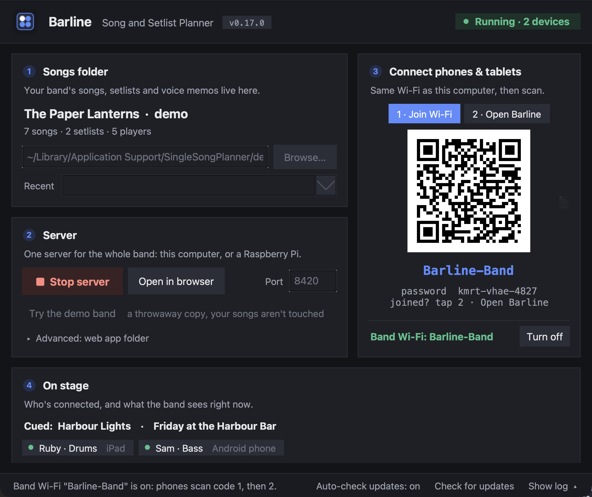

# No Wi-Fi at the Venue

Barline never needs the internet. It only needs one Wi-Fi network that the computer running Barline and every phone and tablet are on. If the room has none (a rehearsal cellar, a festival field, a venue whose Wi-Fi keeps devices apart), make one. Pick whichever of these suits you.

## The easy way: let the computer be the Wi-Fi

In the control panel, the **Connect phones & tablets** card has a **Make a Wi-Fi** button at the bottom. When the computer isn't on any network, the button turns blue and the card says "No network here yet".

Click it, keep the name (`Barline-Band`) and the password Barline made up (or type your own, at least 8 characters), and turn it on. Then on each phone:

1. Scan **code 1**: the phone offers to join the Wi-Fi. Say yes. (Or pick `Barline-Band` in the phone's Wi-Fi settings and type the password shown under the code.)
2. Tap **2 · Open Barline** in the control panel and scan that code: Barline opens.

Inside Barline, **Connect a device** shows the same "join the Wi-Fi" code, so you don't have to stand at the computer for every phone. Barline remembers the name and password, so phones that joined once rejoin by themselves next time.

Phones may warn that this Wi-Fi has no internet. That's expected: tell them to stay connected. Closing the control panel turns off a Wi-Fi that Barline turned on.

What happens when you click depends on your computer:

### Linux

One click. Barline asks NetworkManager to make the hotspot (WPA2), with or without any other connection. While it's on, the computer leaves the Wi-Fi it was on. **Turn off** gives it back. A few Wi-Fi adapters can't be a hotspot ("does not support AP mode"); then use one of the other ways below.

### Windows

Barline turns on Windows' **Mobile hotspot** with your name and password. The catch: Windows only makes a hotspot to share a connection, so when the computer has no network at all it usually says no. Barline then opens **Settings › Network & internet › Mobile hotspot** and says what Windows answered.

To make Windows hotspot with no network, once (needs an administrator):

1. Open **Device Manager**, click the computer's name at the top, then **Action › Add legacy hardware**.
2. **Install the hardware that I manually select › Network adapters › Microsoft › Microsoft KM-TEST Loopback Adapter**.
3. In **Control Panel › Network Connections** (or run `ncpa.cpl`), rename the new adapter to `Loopback`, then restart.

From then on Windows has a connection it's willing to "share" even in an empty room, and Barline's button works. In **Mobile hotspot**, turn off **Power saving** so the hotspot doesn't switch itself off while phones are idle between songs.

### Mac

Apple doesn't let apps turn this on (and the old "Create Network" is gone), so Barline opens the right page in System Settings and shows the steps:

1. **System Settings › General › Sharing**: click **(i)** next to **Internet Sharing**.
2. **Share your connection from:** Thunderbolt Bridge (or Ethernet). Nothing has to be plugged in.
3. **To devices using:** Wi-Fi. **Wi-Fi Options**: the same name and password as in Barline's box, security WPA2/WPA3.
4. Turn **Internet Sharing** on, then **Done**.

Back in Barline, click **It's on**: the control panel then shows the join code too. When you're done, turn Internet Sharing off again (Barline's **Turn off…** opens the page).

If your Mac refuses to turn Internet Sharing on with nothing to share, use a phone's hotspot or a travel router (below).

## A phone's hotspot

Turn on the hotspot on one phone (one that isn't going to be on stage, ideally), and join it from the computer and every other device. Then start Barline as usual. Phone hotspots let devices talk to each other, so this works, but the phone's battery drains fast, and some phones switch the hotspot off when nobody uses the internet for a while.

## A small travel router

A pocket Wi-Fi router (the kind sold for hotel rooms) is the sturdiest choice for regular gigs: power it from USB, and every device joins its Wi-Fi, the computer included. No internet needed. Avoid its "guest" network: guest networks keep devices from seeing each other.

## A Raspberry Pi

A Pi set up with `install.sh --hotspot` does the same by itself: at every boot it joins a network it knows, and when there's none (a venue with no Wi-Fi), it makes `Barline-Band`. Nothing to click, no screen needed: the box in your gig bag *is* the setup. See [[Running on a Raspberry Pi]].

## Safety

Whichever way you choose, the network is only as private as its password: anyone who joins it can open Barline and change your songs. Keep a password on it (Barline never makes an open one), and don't share the code beyond the band.
