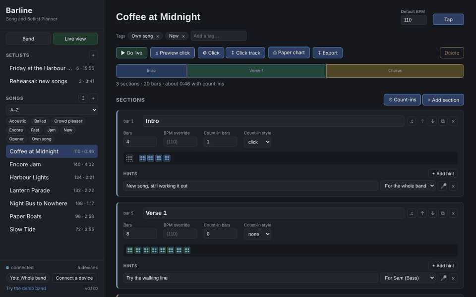
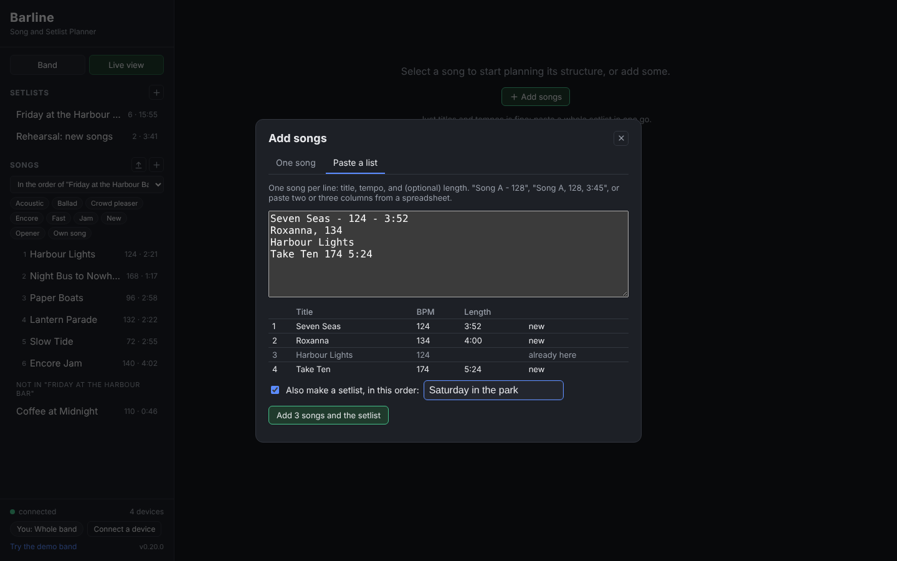
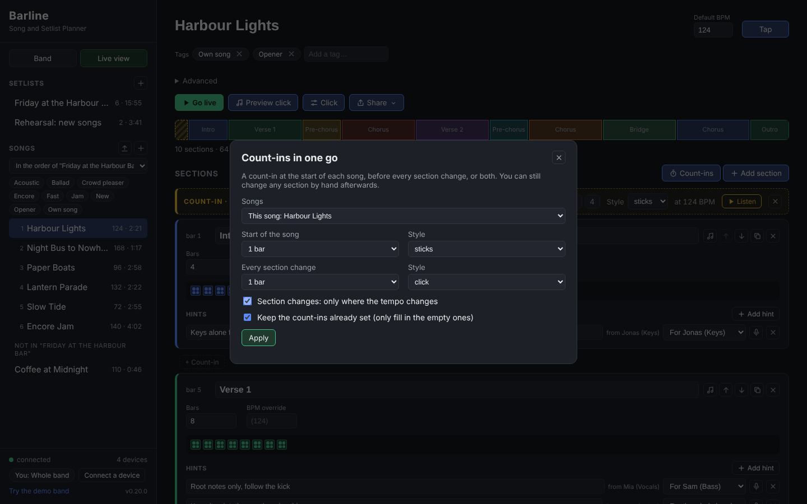
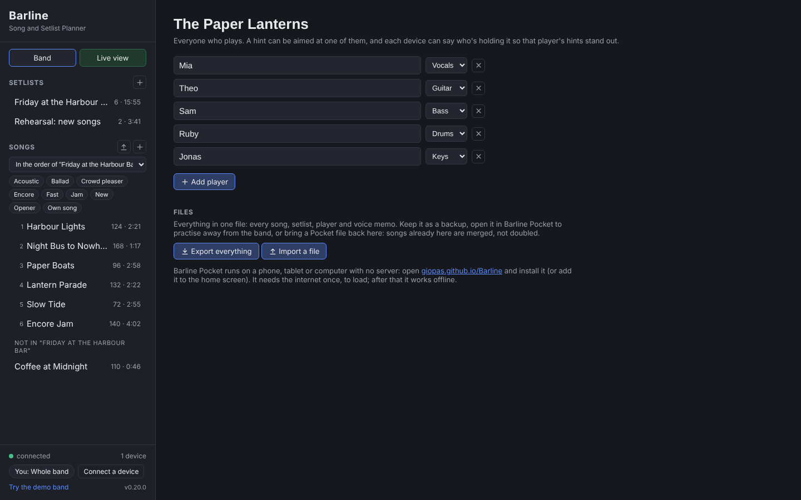
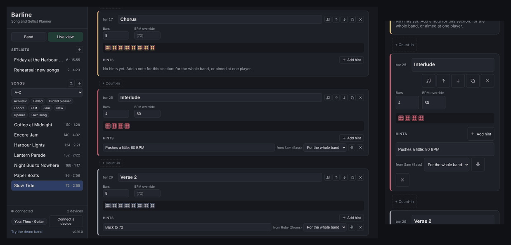
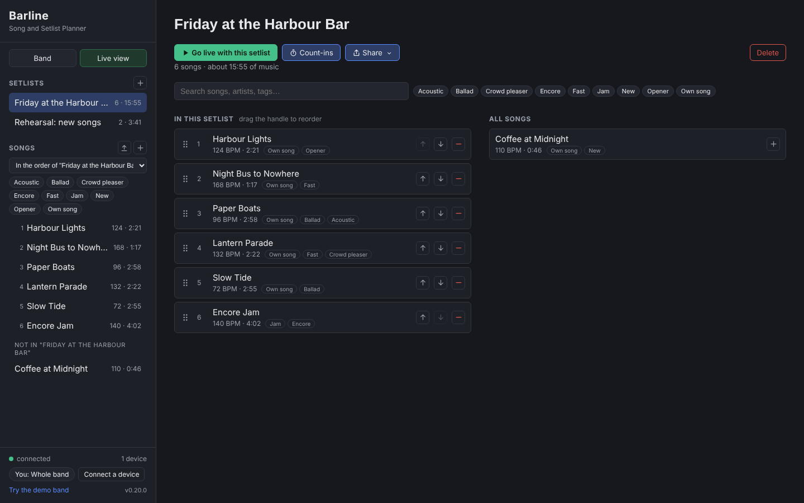

# Planning a Song

This is where the band agrees, in writing, how a song actually goes, so nobody's guessing on stage whether the bridge repeats twice or three times.

## The quick way: just a title and a tempo

The **+** next to *Songs* opens **Add songs**. A title and a tempo is enough for the click: Barline makes one section long enough for the length you give (four minutes if you don't). **Tap** sets the tempo by tapping along. **Add and plan sections** takes you straight to the full editor; **Add song** clears the form for the next one.

**Paste a list** takes a whole set at once, one song per line: `Harbour Lights - 124`, `Paper Boats, 96, 3:45`, or two or three columns pasted from a spreadsheet. It shows what it understood before adding anything, reuses songs you already have, and can make the setlist in the same order. The editor has a **Tap** button next to *Default BPM* too.

## Sections

A song is a list of sections, in order: intro, verse, chorus, bridge, outro, whatever your song has. Click **+ Add section** and give it a name. The sections show up as a row of colored blocks along the top, one color each, so you can see the shape of the song at a glance. Click a block to jump to that section.

Use the arrows on a section to move it up or down. If a section repeats exactly (the second chorus is the same as the first), click the duplicate button: Barline copies its bars, tempo, count-in and hints and puts the copy right after it.

## Bars

Every section needs a bar count: how many bars it lasts. If your verse is 16 bars, type 16. This number is what makes everything else work: it's how Barline knows when one section ends and the next begins. Each section shows its starting bar ("bar 17") so you can check the arrangement against a recording.

The bars are drawn as little squares, four dots in each for the four beats.

## Tempo (BPM)

Every song has a default BPM. Most sections just use it. If one section is deliberately slower or faster, a half-time bridge say, give that section its own BPM and Barline uses it just for those bars. The live view and the metronome both follow the change.

## Count-ins

A count-in is extra bars played *before* a section, so everyone comes in together. Pick a style per section:

- **sticks**: the drummer clicks the sticks
- **click**: a metronome click
- **verbal**: someone counts out loud ("one, two, three, four")
- **none**: straight in

and how many bars. A count-in doesn't eat into the section: a 4-bar intro with a 1-bar count-in plays five bars in total. Each section has a yellow count-in row above it: pick the bars (1, 2, 4 or any 0 to 8), the style, and press **▶ Listen** to hear the count-in and the first bar at that section's tempo. It shows on the overview strips and in the live song list as its own block.

Count-ins aren't just for the top of a song. After a dead stop in the middle, give the next section a count-in, and the live view counts the band back in.

When you start a song from the live view, there's always a count-in first, even if the first section has none set: one bar of click, so nobody's surprised by bar 1.

### Count-ins in one go

**⏱ Count-ins** (next to **+ Add section**, and on a setlist's toolbar) sets them across a whole song, or every song at once:

- **Songs**: this song, every song in a setlist it's in, or every song.
- **Start of the song**: the first section's count-in (leave it, none, 1, 2 or 4 bars; click, sticks or verbal).
- **Every section change**: every later section's, or with **only where the tempo changes**, just the sections that change tempo.
- **Keep the count-ins already set** (on by default) only fills in sections that have none, so the ones you set by hand stay.

Every device sees the change straight away. "No count-in" takes them out again.

Press the ♫ button on a section to hear its count-in and first two bars on this device, or **Preview click** at the top for the whole song.

## Hints

A hint is a short note on a section: a reminder the band (or one player) needs right then. "Root notes only here", "watch for the tempo drop", "everyone in on the 'and'".

Every section has a **+ Add hint** button. Type the note, then use the menu next to it to pick who it's for: **For the whole band** (the default), or **For** one player. That's all there is to it; it saves as you type. A hint for one player stands out on that player's screen (with "For you" on it) and stays out of everyone else's way, though anyone can still choose to see it.

Players are set up on the **Band** page: a name and an instrument each.

### Voice memos

Some things are easier to hear than read: how a fill goes, a sung phrase, "count it like this". The 🎤 button on a hint attaches a short recording (up to 30 seconds) that anyone can play back with ▶.

On the computer running the server, the button records straight from the microphone. Phones and tablets connected over Wi-Fi can't do that (browsers only allow the microphone on secure or local pages), so there the button lets you pick an audio file instead: record it with the phone's voice memo app first, then attach it.

## Everyone at once

Everybody connected sees the same song, and changes show up on every screen within a moment. If two people change the same song at the same moment, the last one saved wins. Barline tells you when someone else changed the song you're looking at.

To delete a song, open **Advanced** at the top of its page: **Delete this song** is at the bottom, away from the everyday buttons. It goes from every setlist, on every device.

## Building a setlist

Click **+** next to Setlists. Add songs from "All songs" on the right, then put them in playing order: drag a song by its handle (the six dots; mouse or finger), or use the arrows (on a phone, dragging is the way). The setlist shows how long the set runs, count-ins included. Switching between songs and setlists is instant; there's no loading screen.

The song list in the sidebar follows the setlist you're looking at: its songs first, numbered in playing order, then the songs that aren't in it. It stays that way when you open a song, so you can walk through the set from the sidebar. The menu above the list switches back to **A–Z** or to another setlist's order (each device remembers its own choice).

The search box above the setlist finds songs by title or tag, in the setlist and in "All songs". While searching or filtering, dragging is off (clear the search to reorder).

## Tags

Give a song tags under its title: type one and press Enter (or pick one already in use). Tags are whatever helps your band: *Own song*, a cover's artist, *Ballad*, *Acoustic*, *Encore*... Up to twelve per song; the spelling already in use is reused, so "own song" and "Own song" stay one tag.

Click a tag in the sidebar (or above the setlist) to show only songs with it; pick more than one to see songs with **any** of them. **× all songs** clears the filter.

## Next

When a song's ready, see **[[Tablet on Stage]]** for playing it live.
