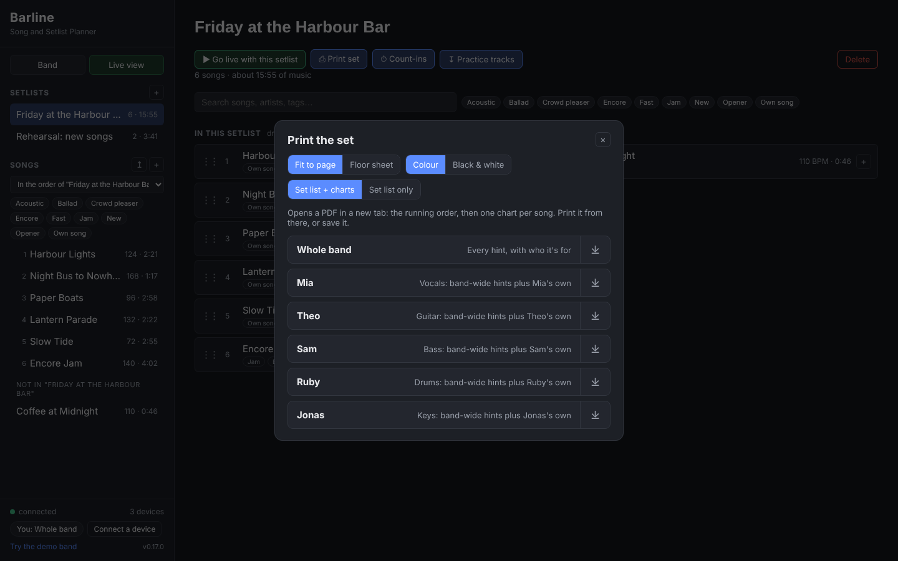
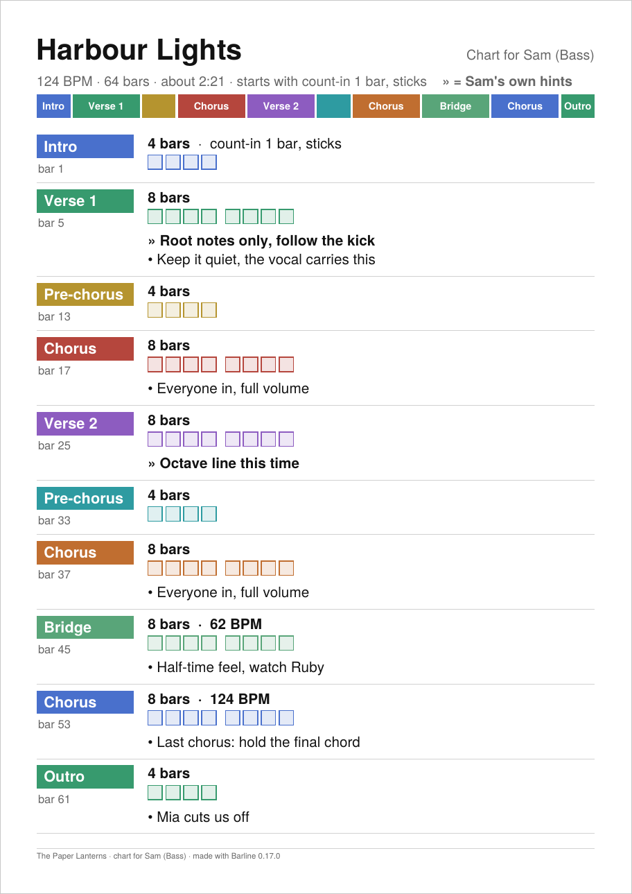
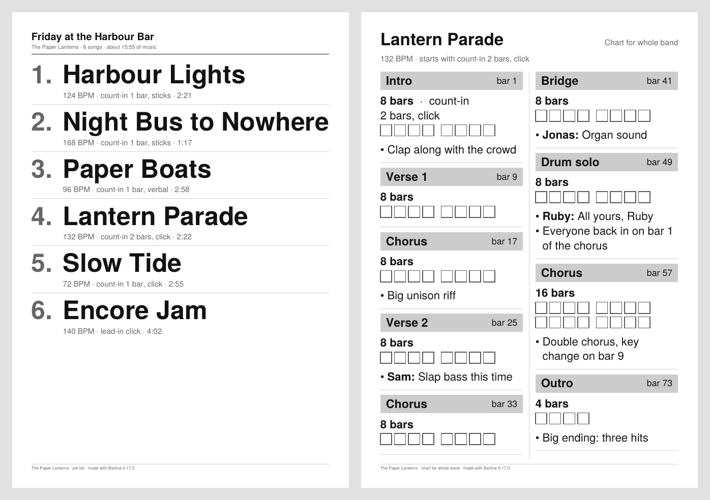

# Printing and Moving Songs

## Paper charts

Sometimes paper is the backup you want: on a music stand, taped to the floor, or in a rehearsal folder. **⎙ Paper chart** on a song (or **⎙ Print set** on a setlist) opens a PDF in a new tab; print it from there, or save it. The ⤓ button next to each choice downloads the PDF instead.

First pick who it's for:

- **Whole band**: every section, every hint, each with who it's for.
- **One player**: the band-wide hints plus that player's own, marked with **»**. Other players' hints are left off.

### What's on the page

- The title, the tempo, how many bars, about how long, and how the song starts (its count-in, or the one-bar lead-in click a live run adds).
- The song's shape: a coloured strip, one block per section, as long as the section.
- Each section, with its name on the left and the bar it starts on, then:
  - how many bars, with a box per bar to count along on (in groups of four);
  - the new tempo when it changes ("62 BPM"), and its count-in if it has one;
  - its hints. A hint with a voice memo says "(voice memo)" so you know there's something to listen to on the tablet.

A section is never split across two pages.

### Size

- **Fit to page** (the default): the type grows until the page is full, without adding a page. If a slightly smaller type gets the song onto one sheet instead of two, it takes it: turning a page mid-song costs more than a slightly smaller number.
- **Floor sheet**: the biggest type that fits on **one** page, for a sheet at your feet read from standing. Portrait and landscape, one and two columns are all tried and the biggest type wins. In two columns the section names sit on a band across the top, with a rule down the middle so the columns never read as one. A song too long for one page at a readable size goes onto two.

### Colour or black and white

**Colour** gives each section the same colour it has on screen, darkened a little so it reads on white paper. **Black & white** uses light grey bands with black names instead: much less toner than black bands, and grey survives a photocopy better.

Barline remembers these choices on each device.

### A whole set

**Print set** starts with the running order on one page, in the biggest type that fits: number, title, and underneath, the tempo, how it starts and how long it is. Then each song's chart, each starting on a new page, with "song 3 of 6" in the footer. **Set list only** prints just the running order, the sheet that gets taped to the stage floor.

### The song is inside its PDF

A song's PDF carries the song itself, voice memos included, as an attachment (a PDF viewer lists it as `song.ssp.json`). Pick the PDF with the ⇡ import button and you get the song back, so emailing a chart to another band's Barline is enough. A set's PDF doesn't carry its songs; export them one by one (below).

The PDFs are made by Barline itself, with nothing to install: the idea and the code come from [Song Notation Tool](https://github.com/giopas/song-notation-tool).

## Taking a song to another setup

Every song is one small file in your songs folder, so you can copy it to another Barline by hand. That works, except for voice memos, which live in their own folder.

The easy way is **Export** on the song: it downloads one `.ssp.json` file with the song *and* its voice memos inside. On the other Barline, click the ⇡ button next to Songs and pick the file (a song's paper-chart PDF works too). The song arrives as a new song; it never overwrites anything that's already there, even if it's the same song imported twice.

That's also how to share a song's structure with another band, or keep a backup of one song before a big rearrangement.

## Backing up everything

Copy the whole data folder (the one you picked in the control panel). That's everything: band, songs, setlists, voice memos. To restore, point the control panel at the copy.
